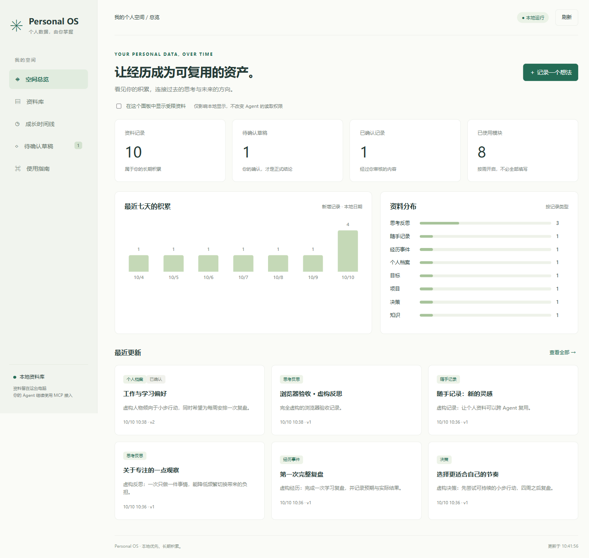
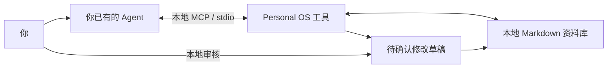

# Personal OS · 本地个人数据框架

**你的资料留在自己的电脑，你的 Agent 通过 MCP 使用它。**

Personal OS 是一个可自用、可修改的开源个人资料框架与本地 MCP 工具。它帮助你持续记录经历、思考、项目、目标和决策，让不同 Agent 基于同一份长期资料协助你。无需注册，不提供集中托管，不调用模型 API，不收集遥测。

[English](README.en.md) · [接入指南](docs/AGENTS.md) · [数据规范](docs/DATA-SPEC.md) · [AI 交互协议](docs/AI-PROTOCOL.md) · [隐私与边界](docs/PRIVACY.md) · [验证记录](docs/VERIFICATION.md)



## 本地可视化面板 · v0.2

安装并初始化资料库后，一条命令启动面板：

```powershell
.venv\Scripts\python.exe -m personal_os.cli --vault D:\PersonalData\my-vault dashboard
```

自动打开本机浏览器，查看记录总览、七天积累、资料分布、时间线、搜索和版本历史；也能保存想法，对比草稿并批准或拒绝。面板每 30 秒刷新，和 Agent 使用同一份资料库。

只监听 `127.0.0.1`，默认地址为 `http://127.0.0.1:8765`，无外部字体、脚本或图表服务。无需安装前端开发环境。[启动与使用说明](docs/DASHBOARD.md)



## 它能做什么

- 保存你授权记录的原始表达，保留来源、时间和标签。
- 搜索资料、读取证据，供 Agent 讨论与复盘。
- 生成正式档案或修改草稿，由你在本地审核后生效。
- 保留版本历史，支持删除当前记录和从历史恢复。
- 使用普通 UTF-8 Markdown；复制整个资料库即可迁移和备份。

**通用意味着面向 MCP 协议，而不是保证每个品牌、每个版本都能直接连接。** Codex、Claude Code、ZCode、WorkBuddy 等工具，需要支持运行本地 stdio MCP 服务，或有对应的本地桥接能力。具体兼容状态见接入指南。

## 五分钟开始

需要 Python 3.11+。请把真实资料库放在代码仓库以外。

### Windows PowerShell

```powershell
git clone https://github.com/sowapolo425-art/personal-os.git
cd personal-os
python -m venv .venv
.venv\Scripts\python.exe -m pip install -e .
.venv\Scripts\python.exe -m personal_os.cli --vault D:\PersonalData\my-vault init
```

### macOS / Linux

```sh
git clone https://github.com/sowapolo425-art/personal-os.git
cd personal-os
python3 -m venv .venv
.venv/bin/python -m pip install -e .
.venv/bin/python -m personal_os.cli --vault "$HOME/PersonalData/my-vault" init
```

### 连接你的 Agent

在 Agent 的本地 MCP 设置中添加下列配置；替换为你自己的**绝对路径**：

```json
{
  "mcpServers": {
    "personal-os": {
      "command": "D:\\tools\\personal-os\\.venv\\Scripts\\python.exe",
      "args": ["-m", "personal_os.cli", "--vault", "D:\\PersonalData\\my-vault", "serve"]
    }
  }
}
```

不同 Agent 的配置外层格式可能不同。Codex 使用 TOML，具体示例见 [接入指南](docs/AGENTS.md)。此工具使用 stdio，无端口，无需后台服务。

### 开始使用

将 [AI-PROTOCOL.md](docs/AI-PROTOCOL.md) 加入 Agent 的规则或上下文，然后尝试：

> /capture 记录这段反思：今天我发现，把目标拆成每周行动更容易坚持。请保留原文。

> /review 结合已有资料，复盘最近的目标变化；请引用记录 ID，缺少资料不要猜测。

> 请整理我的工作偏好，先提交草稿，不要直接更新正式档案。

指令是 Agent 行为约定；服务器不会解析对话或自动切换会话模式。Agent 要真正调用工具，记录才会保存。

### 审核与恢复

```powershell
# 用安装时的 Python 路径执行，下方 ID 替换为工具返回的真实 ID
.venv\Scripts\python.exe -m personal_os.cli --vault D:\PersonalData\my-vault proposals
.venv\Scripts\python.exe -m personal_os.cli --vault D:\PersonalData\my-vault show-proposal <PROPOSAL_ID>
.venv\Scripts\python.exe -m personal_os.cli --vault D:\PersonalData\my-vault approve <PROPOSAL_ID>
.venv\Scripts\python.exe -m personal_os.cli --vault D:\PersonalData\my-vault reject <PROPOSAL_ID>
.venv\Scripts\python.exe -m personal_os.cli --vault D:\PersonalData\my-vault delete <RECORD_ID> --revision 1
.venv\Scripts\python.exe -m personal_os.cli --vault D:\PersonalData\my-vault restore <RECORD_ID> --revision 1
```

先查看草稿，再选择批准或拒绝；也可以在本地面板中对比与审核。批准、删除、恢复没有暴露为 MCP 工具。Agent 若本来具有完整的电脑或终端权限，仍可绕过这个流程；请通过 Agent 自身的权限设置控制这一点。

删除只移除当前记录，历史和草稿仍可能保留其内容。完整清除与备份处理见隐私文档。

## 数据结构

```text
my-vault/
├── 00-System/       使用说明
├── 01-Inbox/        随手记录
├── 02-Journal/      思考与反思
├── 03-Timeline/     经历与事件
├── 04-Self/         经确认的个人档案
├── 05-Goals/        目标
├── 06-Projects/     项目
├── 07-Decisions/    决策
├── 08-Knowledge/    知识
├── 09-Governance/   自定义权限与治理说明
└── .personal-os/    草稿、历史和最少审计记录
```

全部模块可留空，不强迫用户填写人生问卷。框架提供 [空白模板](templates/) 和 [虚构示例](examples/fictional-reflection.md)。工具只管理带合法 ID 的记录；普通笔记不自动导入。修改工具管理的 Markdown 时不要改变头部元数据；需要保留版本请走草稿流程。

## 重要边界

本地保存不等于模型在本地运行。Agent 使用云端模型时，工具返回的资料可能进入该供应商的上下文。默认不暴露 `restricted` 记录。Markdown、草稿与历史均为明文，使用者应自行配置磁盘加密、备份和 Agent 权限。

第一版是单人本地工具，搜索为文字匹配；尚未实现向量检索、自动导入历史聊天、加密存储、云端同步、永久删除命令或数字分身自主执行。它提供有来源的决策材料，不保证“最正确的抉择”。

## 项目缘起

项目创作者受到孙宇晨和邵艾伦的采访启发，开始思考如何长期积累属于自己的个人数据。随后通过个人框架设计对话，提炼出适用于不同使用者的结构。本项目未引用尚未核实的采访原话，也不表示受访者参与或认可此项目。

## 开发与验证

```sh
python -m pip install -e ".[dev]"
python -m pytest
```

MIT License。欢迎提交适配说明、问题和改进；Issue 中请使用虚构资料，不上传真实个人档案或密钥。
