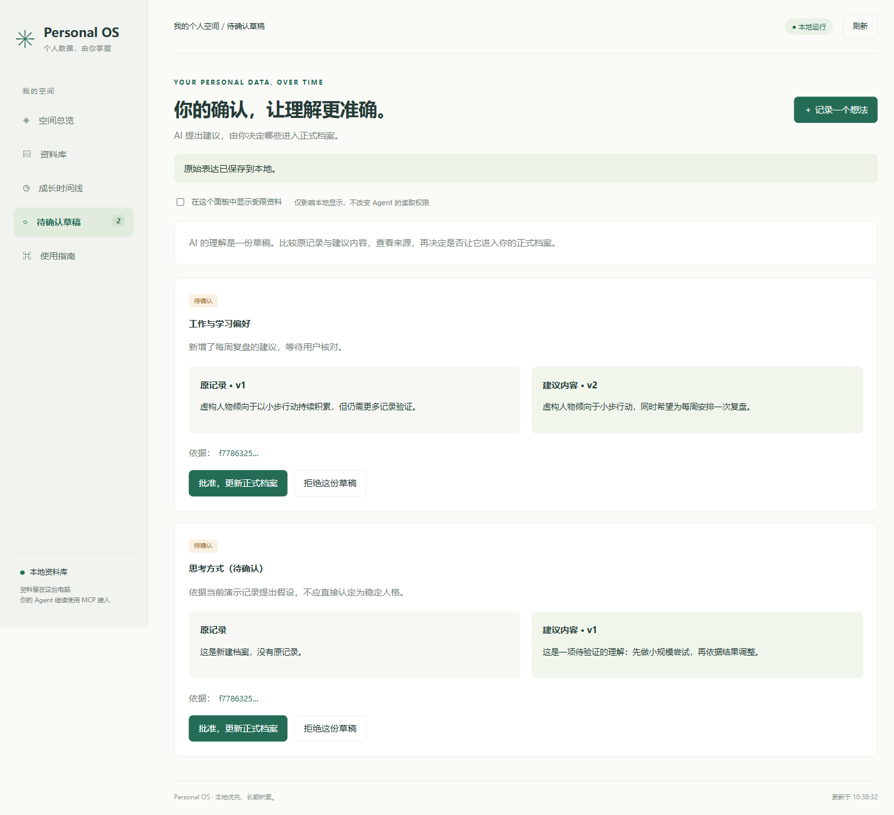

# 本地面板使用说明

## 一键启动

Windows 下载解压源代码后双击 launch.cmd。需要已安装 Python 3.11+；首次选择资料库并安装依赖，之后自动记住所选目录。macOS/Linux 可运行 python3 scripts/launch.py。无图形界面时加 --vault 指定目录。

启动器把虚拟环境放在代码目录 .venv，个人路径选择放在 .local/launcher.json，均不提交。资料库必须在项目目录外。首次安装依赖需要网络，后续版本未变化时不重复安装；不自动升级远程代码。

## 手动启动

安装 Python 包，初始化你自己的资料库，然后启动：

```powershell
.venv\Scripts\python.exe -m personal_os.cli --vault D:\PersonalData\my-vault dashboard
```

浏览器会自动打开 `http://127.0.0.1:8765`。窗口仅连接本机；不需要账户、模型 API 密钥或云端存储。不需要 npm、Node.js 或前端编译。服务需要保持运行，终端按 Ctrl+C 停止。

macOS/Linux 改用 `.venv/bin/python`，资料库使用对应的绝对路径。升级旧代码后，请先重新安装：`python -m pip install -e .`，使用与你安装时一致的 Python 环境。

端口被占用时加 `--port 8766`；不自动打开浏览器时加 `--no-browser`。启动地址始终为本机回环地址，没有向局域网或公网开放的参数。

## 看见你的资料

- 空间总览：可见记录数、待确认草稿数、已确认记录数、已使用的模块。
- 资料库：按标题、正文或标签搜索，按类型筛选；显示最近更新的最多 200 条匹配结果，超过时明确提示。
- 成长时间线：手动记录采用保存时间；导入对话有有效原始创建时间时保留该时间，不猜测人生事件日期。
- 记录详情：原文、来源、关联证据、记录 ID 和历史版本。
- 待确认草稿：并排比较旧记录与建议内容，查看证据，批准或拒绝；版本冲突时不覆盖现有记录。
- 记录想法：直接保存本人原文，不自动调用 AI。
- 资料关联图：查看显式证据引用，点击节点打开原文；最多 60 个节点，优先显示关联较多的记录。
- 导入历史资料：预览、选择、正文去重，默认受限。
- 备份与恢复：下载全部资料备份；校验后恢复到独立目录。
- 使用指南：生成当前环境的 MCP JSON / Codex TOML，可复制到自己的 Agent。
- 跨 Agent 记忆：复制历史/资料提取任务，查看已提交会话、文件和日常记录的提取状态，并打开原文。
- 数据分析：明确选择记录，预览完整 JSON 后下载，交给自己的 Agent 或 API 程序。

上传支持文字 PDF、DOCX、UTF-8 MD/TXT 和对话 JSON。上传/输入只保存原文；
用户再向已连接的 Agent 发起提取任务，分析结论以待审核草稿进入资料库。
提取状态是 Agent 的处理报告，不是审核结果或软件全部历史的覆盖证明。
更多说明见 [提取契约](HISTORY-EXTRACTION.md)。

面板和 MCP 连接同一个资料库时，数据互通。页面每 30 秒刷新，查看详情或输入新记录时暂缓刷新；也可点击刷新。图表是实际记录的计数，不是人格评分或 AI 猜测。



## 隐私与本机访问

默认不显示受限记录和受限草稿。用户可主动勾选本地显示受限资料；此开关不修改文件敏感级别，不赋予 Agent 读取受限内容的权限。

面板是面向本机使用者的工具，无密码登录。运行时会启动仅绑定 `127.0.0.1` 的 HTTP 服务。本机其他进程仍可访问；它不是操作系统账户隔离或防恶意本机进程的方案。对其他来源页面的写请求检查 Host、Origin、自定义请求头及 JSON 类型；拒绝跨来源写入，不提供 CORS 开放访问。

内容按纯文本显示，不执行记录中的 HTML 或脚本。静态资源随 Python 包提供，不从外部网站加载。响应禁用缓存和嵌入。面板不会向模型发送资料；Agent 使用云端模型的情况仍按原隐私说明处理。

## 后续可优化

更多导入格式和附件、本地语义检索、独立应用安装包、目标进度字段。这些尚未实现，不把记录数量伪装为目标完成率。v0.5 的删除影响预览、永久本地清理、有效期、冲突裁决与决策复盘见 [记忆生命周期](MEMORY-LIFECYCLE.md)。
